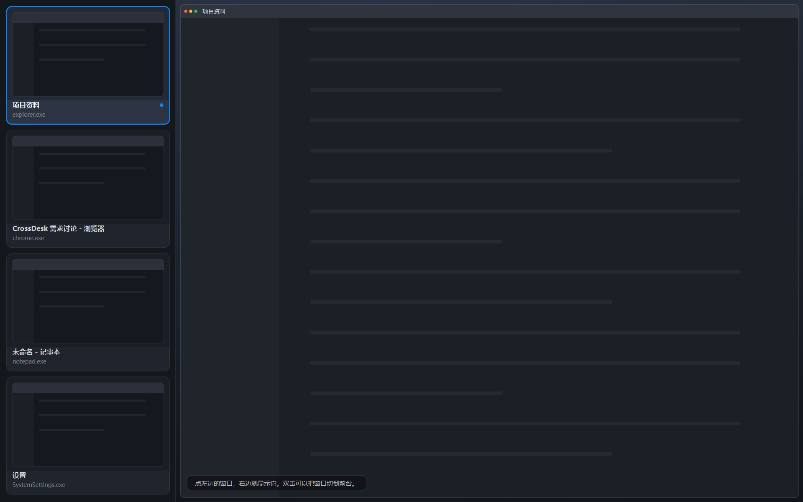
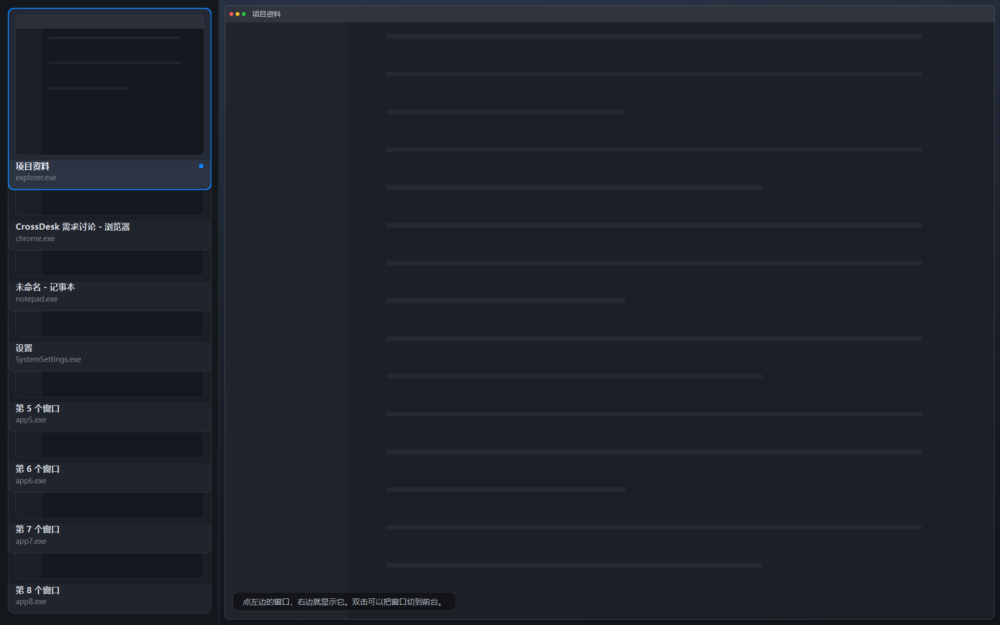
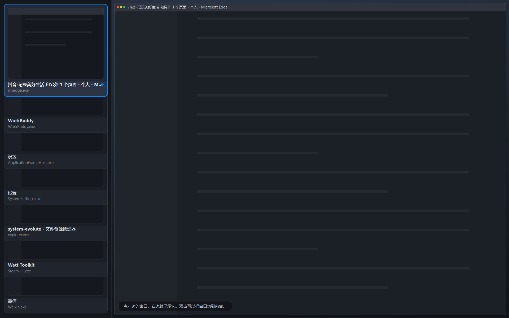

# C · 课程版界面讲解卡

> 分支 `c-ui-fullscreen`（PR #1）。对应 `docs/course-mvp.md` 的 M1–M6 里属于界面的部分。
> 每个文件配"为什么这么写 / 用到哪些 Qt API / 失败路径"，答辩被追问时照着讲。

## 文件分工

| 文件 | 职责 | 一句话 |
| --- | --- | --- |
| `src/ui/window_item.h` | 数据 | 界面只认识 `WindowId` + 标题 + 进程名，不含 `HWND` |
| `src/ui/crossdesk_service.h` | 边界 | UI 与核心之间唯一的抽象，4 个方法 + 2 个信号 |
| `src/ui/fake_service.*` | 假数据 | 默认 4 个窗口；`--fake-many` 给 8 个，用来看叠影 |
| `src/ui/live_service.*` | 真数据 | 调 A 的扫描器读真实窗口，命令走 A 的接口 |
| `src/ui/window_cards.*` | 左栏 | 一张窗口卡 + 会叠起来的卡片堆（点击换前、拖动抽出） |
| `src/ui/preview_widgets.*` | 右栏 | 一个窗口铺满画面的画布；另留了"桌面全览 / 两列"两种画法 |
| `src/ui/layout_math.*` | 布局 | 等宽 / 60:40 的纯函数，B 的实现替换点（当前没有调用点） |
| `src/ui/main_window.*` | 界面 | 全屏两栏、选中、快捷键、动画、失败反馈 |
| `tests/ui_smoke.cpp` | 测试 | 23 项断言，无显示器可跑 |

## 五个必须能讲清的点

**1. 界面为什么不自己存"窗口在哪"？**
界面拿到的是一份快照（`QVector<WindowItem>`），每次刷新整份替换。窗口位置、能不能操作，都由服务说了算。界面只额外记一件服务不关心的事：**哪个窗口上次失败了、失败原因是什么**（`m_failures`）。这不构成"第二份真相"，因为它只在收到结果信号时写入。

**2. 为什么命令不返回 bool？**
`activateWindow()` / `placeWindow()` 都是 `void`，结果走 `operationFinished(OperationResult)`。因为真实实现是系统调用：`SetForegroundWindow` 返回 true 只代表"调用发出了"，窗口可能被系统拒绝。只有逐窗回报才说得清是哪一个失败——这就是 `OperationResult.window` 的用途。

**3. 为什么点一下就换右边，而不是勾选框？**
这一版的交互是"左边挑一个、右边看一个"，不是"挑两个再排列"。勾选框要求用户先建立"我要选几个"的心理模型；点击没有这个问题，点谁看谁。代码上也就没有 `m_checked` 这个数组，只有 `m_selected` 一个 id。

**4. 叠影时点一下，为什么那张会跑到最前面？**
`CardStack::promote()` 把它在 `m_cards` 里移到下标 0，然后重排：下标 0 的那张 y 最小（在最上面），同时最后 `raise()`。视觉上就是"抽出来放到最前"。拖动走的是同一条路——拖动只是让卡片先跟着鼠标走，松手后同样 `promote()`，所以"点"和"拖"最后落在同一段代码上，不会有两套行为。

**5. 卡片为什么不用 `QListWidget`？**
`QListWidget` 的行是"一行文字 + 左边一个图标"，做不出"上面一张画面、下面一行字、还能互相压住"的效果。`WindowCard` 自己画整张卡，`CardStack` 自己管几何和层叠顺序——层叠顺序就是 `m_cards` 的下标，没有第二种真相。

## 失败路径（老师最爱问）

| 场景 | 界面怎么表现 |
| --- | --- |
| 定位被系统拒绝 | 状态条红字写明原因 |
| 选中的窗口被关掉 | 下一次刷新自动换成第一个，状态条说明，右边不会空着 |
| 窗口全关掉 | 左栏空、右栏空，不崩 |
| 一个窗口都没有 | 右栏画"没有可管理的窗口"，不是一块黑 |
| 平台命令未接入 | 明确说"等待 A 的接口"，绝不假装成功 |

## 动画（M4）

| 过渡 | 做法 | 时长 |
| --- | --- | --- |
| 打开总览 | `windowOpacity` 0→1，`OutCubic` | 180ms |
| 换窗口 | 右栏画面 `opacity` 0.25→1 | 150ms |
| 卡片重排 | 每张卡的 `geometry` 补间，`OutCubic` | 160ms |
| 收起总览 | 淡出后最小化（全局热键未接入时） | 140ms |

收起用"最小化"而不是"隐藏"：全局 `Ctrl+Alt+M` 由 A 注册，现在没有。真 `hide()` 会让窗口从任务栏消失且叫不回来，这正是交接文档警告的"操作后用户找不到窗口"。接入后加 `--allow-hide` 即可切成真隐藏。

## 手工测试步骤

```bat
run-fake.bat
```

1. 左栏四张卡，每张上面是这块窗口的画面、下面是标题和进程名。
2. 点第二张 → 右栏换成它，卡片描蓝边。
3. `Ctrl+Enter`（或双击卡片）→ 目标窗口被切到前台。
4. 点「设置」再定位 → 红字提示被系统拒绝。
5. `Ctrl+R` → 刷新，卡片数跟着变，右栏不会闪。
6. `Esc` → 最小化到任务栏。

```bat
run-fake-many.bat
```

7. 八张卡叠在一起，第一张完整、其余只露出下面那条标题。
8. 点（或按住拖出）第八张 → 它跑到最前，右栏显示它。

## 界面结构（2026-10-20 卡片版）

四张卡平铺（`--fake`）：



八张卡改成叠影（`--fake-many`）：



真实桌面上的窗口（`run.bat`）：



```
┌──────────────┬──────────────────────────────────────┐
│ ┌──────────┐ │                                      │
│ │  画面     │ │                                      │
│ ├──────────┤ │        选中的那个窗口，铺满            │
│ │标题/进程  │ │                                      │
│ ├──────────┤ │                                      │
│ │  画面     │ │                                      │
│ ├──────────┤ │                                      │
│ │标题/进程  │ │                                      │
│ └──────────┘ │                       [状态条]        │
└──────────────┴──────────────────────────────────────┘
```

- **无边框 + `showFullScreen()`**：这不是一个"应用窗口"，是盖在桌面上的一层总览。
- **左栏**：四张卡以内竖着平铺，每张等分高度、正好铺满；五张起改成叠影——
  最前那张完整，其余每张往下挪一段、只露出下面那条标题。
- **右栏**：只画选中的那一个窗口，铺满整块区域（`showSingle()` 给的矩形就是整个可用区域）。
- 状态条浮在画面左下角，不占布局。

四个必须讲清的决定：

1. **为什么左边最多四个**
   四张卡平铺之后每张还有足够高的画面区；再多就只能压缩到只剩标题，不如干脆叠起来。
   `kMaxTiled = 4` 就是这一条，改这一个常量就能换阈值。

2. **为什么叠影露出的是"下面那条字"**
   卡片结构是"上面画面、下面文字"。叠起来时上面那张盖住下面那张的上半部分，
   正好露出标题条——所以不用为叠影单独设计一套排版。

3. **为什么右栏只画一个窗口、还要铺满**
   用户点一下是想知道"这个窗口长什么样"，不是"它在屏幕哪个角落"。
   所以 `showSingle()` 直接给它整个可用区域，跟窗口原来的 bounds 无关。

4. **为什么刷新时右栏不重放淡入**
   `showSelected(bool animate)` 里，刷新路径传 false。否则每次 Ctrl+R 都会闪一下，
   而刷新本身并没有换窗口。

## 平台命令层（2026-10-20 补）

之前「定位」在真实模式下只会回一句"等待 A 的接口"，因为 A 的
`Win32ApiAdapter` 只有查询、没有命令。现在补了一份兜底实现：

| 文件 | 位置 | 归属 |
| --- | --- | --- |
| `src/platform/windows/win32_window_commands.*` | 平台层 | **A 的地盘**，A 接好适配器后直接删掉 |
| `src/ui/live_service.cpp` 里的两处调用 | 界面层 | 只调服务接口，没有 windows.h |

三个实现要点（答辩可以直接讲）：

1. **置前要先还原**：`IsIconic()` 判断是否最小化，是就先 `SW_RESTORE`；否则
   `SetForegroundWindow` 对一个最小化窗口不会产生用户可见的效果。
2. **前台锁定要兜底**：Windows 只允许"当前前台进程"把前台权交出去，被别的进程
   抢过焦点就会失败。兜底是 `AttachThreadInput` 临时挂到目标线程的输入队列上，
   借它的权限完成置前。
3. **`SetWindowPos` 返回 true 不等于成功**：提权窗口、部分商店应用会"调用成功但
   拒绝执行"。所以摆位后必须 `GetWindowRect` 回读一次，偏差超过 2px 就判定失败。

真机验证 `tests/win32_commands_smoke.cpp`（7 项断言，全部通过）：

```
PASS 找到真实目标窗口
PASS place() 返回成功
PASS 系统里窗口矩形确实变成了目标值 | left=120 top=140 w=900 h=620
PASS activate() 返回成功
PASS 前台窗口确实变成了目标窗口
PASS 对不存在的句柄返回失败而不是崩溃
PASS 失败时给出了可读原因
```

## 构建踩坑：MSVC 必须加 /utf-8

源码里的中文注释是 UTF-8，MSVC 默认按 GBK 读。GBK 把 UTF-8 的多字节序列拆错后，
严重时一个中文字节会把行尾换行吃掉，让下一行代码并进注释，报出
`语法错误: "public"` 这种和代码完全对不上的错误。`CMakeLists.txt` 里已加
`add_compile_options(/utf-8)`，同时保证中文字面量按 UTF-8 存进 exe（否则界面会花）。

## 三个答辩追问题

1. **界面怎么知道窗口被关了？**
   下一次 `refresh()` 的快照里找不到这个 id。判断依据是"它在不在整份快照里"，不是"它从这一行消失了"。

2. **`layout_math.cpp` 为什么还留着？**
   它属于 B 的职责（两窗布局规则）。这一版界面暂时没有"排列"入口，但文件保留：
   换 B 的实现时不用重新接一遍，界面这边的调用点也只有一处。

3. **预览画布为什么不自己修正矩形？**
   画布只做"缩放 + 摆放"。如果比例不对，那是 B 的输入错了；界面偷偷修正会把问题藏起来，出问题时说不清是谁的责任。
