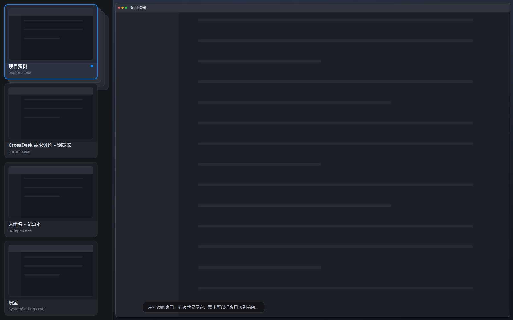
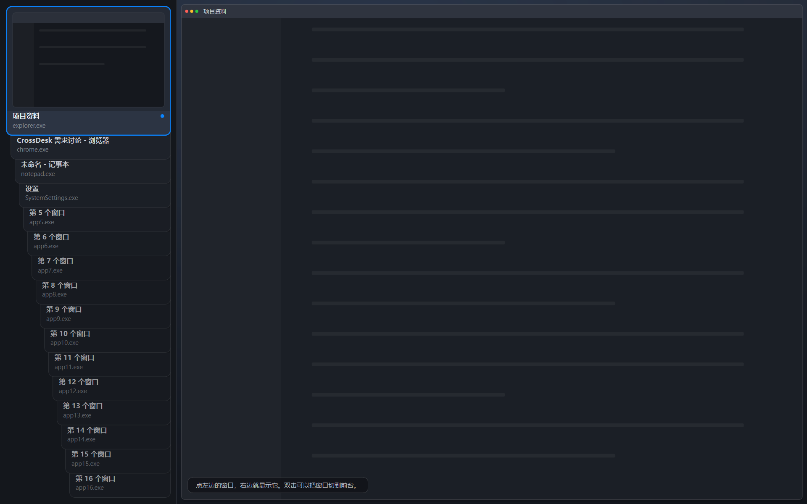
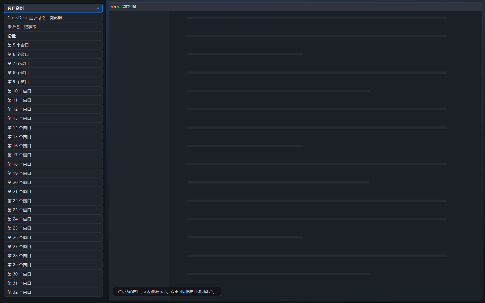

# C · 课程版界面讲解卡

> 分支 `c-ui-fullscreen`（PR #1）。对应 `docs/course-mvp.md` 的 M1–M6 里属于界面的部分。
> 每个文件配"为什么这么写 / 用到哪些 Qt API / 失败路径"，答辩被追问时照着讲。

## 文件分工

| 文件 | 职责 | 一句话 |
| --- | --- | --- |
| `src/ui/window_item.h` | 数据 | 界面只认识 `WindowId` + 标题 + 进程名，不含 `HWND` |
| `src/ui/crossdesk_service.h` | 边界 | UI 与核心之间唯一的抽象，4 个方法 + 2 个信号 |
| `src/ui/fake_service.*` | 假数据 | 默认 4 个窗口；`--fake-many` 给 8 个，`--fake-count N` 想看几档看几档 |
| `src/ui/live_service.*` | 真数据 | 调 A 的扫描器读真实窗口，命令走 A 的接口 |
| `src/ui/window_cards.*` | 左栏 | 一张窗口卡 + 卡片堆（四张以内平铺、第一张背后垫影子；多了斜着叠） |
| `src/ui/preview_widgets.*` | 右栏 | 一个窗口铺满画面的画布；另留了"桌面全览 / 两列"两种画法 |
| `src/ui/layout_math.*` | 布局 | 等宽 / 60:40 的纯函数，B 的实现替换点（当前没有调用点） |
| `src/ui/main_window.*` | 界面 | 全屏两栏、选中、快捷键、动画、失败反馈 |
| `tests/ui_smoke.cpp` | 测试 | 63 项断言，无显示器可跑；[本轮修复与验证](pr1-review-fixes.md) |

## 五个必须能讲清的点

**1. 界面为什么不自己存"窗口在哪"？**
界面拿到的是一份快照（`QVector<WindowItem>`），每次刷新整份替换。窗口位置、能不能操作，都由服务说了算。界面只额外记一件服务不关心的事：**哪个窗口上次失败了、失败原因是什么**（`m_failures`）。这不构成"第二份真相"，因为它只在收到结果信号时写入。

**2. 为什么命令不返回 bool？**
`activateWindow()` / `placeWindow()` 都是 `void`，结果走 `operationFinished(OperationResult)`。因为真实实现是系统调用：`SetForegroundWindow` 返回 true 只代表"调用发出了"，窗口可能被系统拒绝。只有逐窗回报才说得清是哪一个失败——这就是 `OperationResult.window` 的用途。

**3. 为什么点一下就换右边，而不是勾选框？**
这一版的交互是"左边挑一个、右边看一个"，不是"挑两个再排列"。勾选框要求用户先建立"我要选几个"的心理模型；点击没有这个问题，点谁看谁。代码上也就没有 `m_checked` 这个数组，只有 `m_selected` 一个 id。

**4. 叠影时点一下，为什么那张会跑到最前面？**
`CardStack::promote()` 把它在 `m_cards` 里移到下标 0，然后重排：下标 0 的那张 y 最小（在最上面），同时最后 `raise()`。视觉上就是"抽出来放到最前"。拖动走的是同一条路——拖动只是让卡片先跟着鼠标走，松手后同样 `promote()`，所以"点"和"拖"最后落在同一段代码上，不会有两套行为。

**5. 卡片为什么不用 `QListWidget`？**
`QListWidget` 的行是"一行文字 + 左边一个图标"，做不出"上面一张画面、下面一行字、还能互相压住"的效果。`WindowCard` 自己画整张卡，`CardStack` 自己管几何和层叠顺序——层叠顺序就是 `m_cards` 的下标，没有第二种真相。

## 失败路径（老师最爱问）

| 场景 | 界面怎么表现 |
| --- | --- |
| 定位被系统拒绝 | 状态条红字写明原因 |
| 选中的窗口被关掉 | 下一次刷新自动换成第一个，状态条说明，右边不会空着 |
| 窗口全关掉 | 左栏空、右栏空，不崩 |
| 一个窗口都没有 | 右栏画"没有可管理的窗口"，不是一块黑 |
| 平台命令未接入 | 明确说"等待 A 的接口"，绝不假装成功 |

## 动画（M4）

| 过渡 | 做法 | 时长 |
| --- | --- | --- |
| 打开总览 | `windowOpacity` 0→1，`OutCubic` | 180ms |
| 换窗口 | 右栏画面 `opacity` 0.25→1 | 150ms |
| 卡片重排 | 每张卡的 `geometry` 补间，`OutCubic` | 160ms |
| 收起总览 | 淡出后最小化（全局热键未接入时） | 140ms |

收起用"最小化"而不是"隐藏"：全局 `Ctrl+Alt+M` 由 A 注册，现在没有。真 `hide()` 会让窗口从任务栏消失且叫不回来，这正是交接文档警告的"操作后用户找不到窗口"。接入后加 `--allow-hide` 即可切成真隐藏。

## 手工测试步骤

```bat
run-fake.bat
```

1. 左栏四张卡从上到下平铺，四张一样大，把整条栏填满。只有第一张的背后垫着三层影子，
   影子往**右下**错开，像一叠卡压在这张下面，露出来的是右边这一条。
2. 鼠标压到右边那条外露的影子上 → 第一张往上提 10px（140ms 补间），移开落回原位。
   压在卡片身上不提——只有外露的框是"抓手"。
3. 按住第一张往外拖 → 卡片跟着鼠标走，影子留在原地；松手滑回原位。
4. `Ctrl+Enter`（或双击卡片）→ 目标窗口被切到前台。
5. 点「设置」再定位 → 红字提示被系统拒绝。
6. `Ctrl+R` → 刷新，卡片数跟着变，右栏不会闪。
7. `Esc` → 最小化到任务栏。

```bat
run-fake-many.bat
```

8. 八张卡叠在一起，第一张完整、其余只露出下面那条标题。
9. 点（或按住拖出）第八张 → 它跑到最前，右栏显示它。

```bat
crossdesk.exe --fake-count 20
crossdesk.exe --fake-count 32
```

10. 二十张：最前那张被压到只剩一条，其余每条都还完整露出一行标题。
11. 三十二张：退化成标题条，一条一条排下去，点第 21 条也照样换到最前。

## 界面结构（2026-10-21 卡片版）

四个窗口平铺填满左栏，第一张背后垫着往右下错开的影子（`--fake`）：



八个窗口，叠得更密（`--fake-many`）：


真实桌面上的窗口（`run.bat`）：


```
┌──────────────┬──────────────────────────────────────┐
│ ┌──────────┐ │                                      │
│ │   画面    │▓│                                      │
│ ├──────────┤▓│        选中的那个窗口，铺满            │
│ │ 标题/进程 │▓│                                      │
│ └──────────┘▓│                                      │
│  ▓▓▓▓▓▓▓▓▓▓  │   ← 影子往右下错开，露出一圈边          │
│ ┌──────────┐ │                                      │
│ │   画面    │ │                                      │
│ ├──────────┤ │                                      │
│ │ 标题/进程 │ │                                      │
│ └──────────┘ │                       [状态条]         │
└──────────────┴──────────────────────────────────────┘
```

- **无边框 + `showFullScreen()`**：这不是一个"应用窗口"，是盖在桌面上的一层总览。
- **左栏**：四张以内平铺，四张一样大，从上到下填满整条栏；只有第一张背后垫三层影子。
  五张起改成带标题的斜叠（见「窗口更多时」）。只有一个窗口时整栏给它。
- **右栏**：只画选中的那一个窗口，铺满整块区域（`showSingle()` 给的矩形就是整个可用区域）。
- 状态条浮在画面左下角，不占布局。

四个必须讲清的决定：

1. **为什么四张平铺，还要在第一张背后垫影子**
   四个窗口是常态，平铺之后每张都看得见、挑起来最快。但平铺像一列列表行，
   看不出"这些是被同一层总览管着的窗口"。所以给第一张垫三层影子：它是这一摞的顶。
   只给第一张垫——四张都垫就成了四摞纸，反而看不出谁是顶。
   四张一样大是硬要求：影子那 30px 是四张一起从宽度里扣的，
   只扣第一张的话它比别的窄一圈。

2. **为什么叠影露出的是"下面那条字"**
   卡片结构是"上面画面、下面文字"。叠起来时上面那张盖住下面那张的上半部分，
   正好露出标题条——所以不用为叠影单独设计一套排版。

3. **为什么右栏只画一个窗口、还要铺满**
   用户点一下是想知道"这个窗口长什么样"，不是"它在屏幕哪个角落"。
   所以 `showSingle()` 直接给它整个可用区域，跟窗口原来的 bounds 无关。

4. **为什么刷新时右栏不重放淡入**
   `showSelected(bool animate)` 里，刷新路径传 false。否则每次 Ctrl+R 都会闪一下，
   而刷新本身并没有换窗口。

## 第一张卡背后的影子界面

四张平铺之后，左栏像"四行列表"。影子补的是"这是一摞窗口"的感觉：
**第一张卡背后垫三层圆角板**，每层往**右下**错开 10px，越远越暗。另外三张是光板。

```
        ┌────────────────────┐
        │    画面 / 标题      │▓
        │                    │▓   ← 影子露在右边（3 层，各 10px）
        └────────────────────┘▓
          ▓▓▓▓▓▓▓▓▓▓▓▓▓▓▓▓▓▓▓▓   ← 下沿露一截，剩下的压在第二张底下
```

六条实现上的约束：

1. **影子不是子控件**，画在 `CardStack::paintEvent` 里。子控件永远画在父控件上面，
   所以影子自动被卡片盖住，露出来的只是右边那一条和右下角——不用自己算裁剪区域。
2. **四张卡统一缩窄 30px**（`kShadowSpan`）：影子往右下走，右边要让出一条，
   但让的是四张一起。只让第一张的话它比别的窄一圈，"四张一样的面积"就没了。
   高度不用再让：第一张下面隔一条缝就是第二张，影子的下半截本来就压在第二张底下。
3. **影子按"落位"画，不按卡片当前位置**（`m_shadowBase`）。拖动、提起时卡片动、
   影子不动，看着才是"从这一摞里抽出来 / 抬起来"；松手滑回去，影子又贴上了。
4. **点影子等于点第一张**：`cardIndexAt()` 给第一张的落位往右下扩 30px 兜底，
   不然那一块点了没反应，像坏了一样。
5. **提起只改 y**：`applyLift()` 把第一张的几何整体上移，宽高一点不动，
   所以四张始终同样大；也不需要重排——重排会把影子一起挪走，就看不出"提"了。
6. **提起只认外露的那条边**（`onShadowEdge()`）：x 在第一张右边、y 从第一层影子开始的那一条。
   压在卡片身上不提——卡片是"看"的，那条边才是"拉"的。

为什么朝右下：影子是"压在这张下面的那几张"，摞纸天然往下错，影子落在下沿；
而"提起来"是往上走，两者方向相反，卡片一动就和影子分开，提起这一下才看得出来。
反过来（影子在右上），往上提反而会撞进影子里。

## 鼠标压到外露的框上：上提

外露的那条影子是这一摞唯一"能碰"的地方，所以在它上面做了一次预告动作：

| 状态 | 表现 |
| --- | --- |
| 鼠标压上去 | 第一张 140ms `OutCubic` 上移 10px，光标变手，影子**不跟**（距离拉开，像被拎起来） |
| 鼠标移开 | 沿同一条曲线落回落位，四张重新对齐 |
| 按住拖动 | 卡片直接跟手走（比提起更远），影子留在落位上 |
| 松手 | 滑回落位，提起状态清零 |

为什么是 10px、140ms：边距正好 12px，提 10px 不会顶出栏外；140ms 比卡片重排的 170ms 短，
这是"碰一下"的反馈，不该比"重新排版"还慢。提起进度用 `QVariantAnimation`（0→1），
不是给 `CardStack` 加 `Q_PROPERTY`——它是"这一下动作"的进度，不是控件状态。

## 窗口更多时

叠影能撑多少张，取决于每张露出来的那条**够不够高**：标题条是 46px，步长一旦小于它，
下面那张的标题就会被上面这张盖掉一半。如果直接写 `step = (高度 - 卡高) / (n - 1)`、
卡高写死 280，16 张时就开始压字，20 张时两行字叠在一起。

所以步长反着算：**先保证每张都露得出一条标题，剩下的高度全给最前那张**
（`CardStack::relayout`，以 1080p、左栏内高 936px 为例）。

| 窗口数 | 每张露出 | 最前那张 | 左右错开 |
| --- | --- | --- | --- |
| 1 | 整栏 | 整栏 | 0 |
| 2–4 | 平铺（第一张背后垫影子） | 等分整栏 | 0 |
| 5–16 | 93 → 46px | 285 → 246px | 17 → 13px |
| 17–20 | 46px（正好一条标题） | 200 → 62px | 8px |
| 21+ | 行高均分（压缩档） | 和别的条一样高 | 0 |

两个机制：

1. **步长下限**：`step = max(46, min(inner*22%, (inner - maxCard) / (n-1)))`，
   卡高 `= inner - (n-1)*step`。窗口越多步长越小，小到 46px 就顶住，
   再多的部分由"最前那张变矮"吸收。
2. **压缩档**：连一条标题都塞不下时（约 21 张起，取决于屏幕高度），
   卡片高度直接等于行高，相邻两张正好不重叠，退化成一列标题——字不会互相压，
   点第 21 条照样能换到最前。圆角从 10 收到 4，否则一排 27px 高的圆角块像药丸。

斜度也跟数量走：`shift = clamp(width*40% / (n-1), 4, 20)` 像素。
少了看不出"斜"，多了最后几张会瘦成一条；压缩档干脆不斜，斜了反而读不出来。

真实模式保留全部合法候选，不再截断为 10 项；压缩档用于窗口较多的情况。
`--fake-count 32` 可以直接查看这一档。

十六张（每张还露得出一条完整标题）：



三十二张（退化成标题条）：



## 平台命令层（2026-10-27 审查后更新）

真实定位通过 `LiveService` 的工作线程执行，界面层不包含 windows.h。
平台 facade `win32_window_commands.*` 使用异步请求并限时回读真实状态，
不再挂接其他进程的输入队列；目标繁忙也不阻塞 Qt。只有已恢复、可见且实际成为
前台窗口才报告定位成功，摆位也必须读到目标矩形。超时仅表示未确认，请求可能
稍后执行。A 的适配器已有命令接口，后续正式核心集成再统一结果模型。

真机测试按启动的子进程 PID 锁定窗口，验证 1000×680 的摆位与置前；
离屏测试用自有隐藏窗口覆盖延迟、拒绝、关闭和服务析构等反例。
完整修复与当前验证范围见[审查修复记录](pr1-review-fixes.md)。

## 构建踩坑：MSVC 必须加 /utf-8

源码里的中文注释是 UTF-8，MSVC 默认按 GBK 读。GBK 把 UTF-8 的多字节序列拆错后，
严重时一个中文字节会把行尾换行吃掉，让下一行代码并进注释，报出
`语法错误: "public"` 这种和代码完全对不上的错误。`CMakeLists.txt` 里已加
`add_compile_options(/utf-8)`，同时保证中文字面量按 UTF-8 存进 exe（否则界面会花）。

## 三个答辩追问题

1. **界面怎么知道窗口被关了？**
   下一次 `refresh()` 的快照里找不到这个 id。判断依据是"它在不在整份快照里"，不是"它从这一行消失了"。

2. **`layout_math.cpp` 为什么还留着？**
   它属于 B 的职责（两窗布局规则）。这一版界面暂时没有"排列"入口，但文件保留：
   换 B 的实现时不用重新接一遍，界面这边的调用点也只有一处。

3. **预览画布为什么不自己修正矩形？**
   画布只做"缩放 + 摆放"。如果比例不对，那是 B 的输入错了；界面偷偷修正会把问题藏起来，出问题时说不清是谁的责任。
